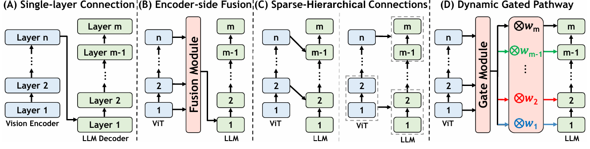
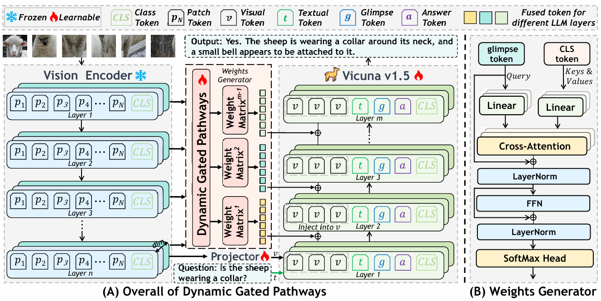

<div align="center">

# [NeurIPS 2026] Where to Connect? Boosting MLLMs via Dynamic Gated Pathways across ALL ViT and LLM Layers


<p>
  Yingying Yan<sup>1,∗</sup>,
  Jiaqi Tang<sup>2,∗</sup>,
  Wei Wei<sup>1,†</sup>,
  Qianzhou Wang<sup>1</sup>,
  Lei Zhang<sup>1</sup>,
  Jianmin Chen<sup>1</sup>,
  Yuyang Xia<sup>1</sup>,
  Botong Geng<sup>1</sup>,
  Jinjian Wu<sup>1</sup>,
  Qifeng Chen<sup>2</sup>
</p>


<p>
<sup>1</sup>Northwestern Polytechnical University &nbsp;&nbsp;
<sup>2</sup>Hong Kong University of Science and Technology
</p>

<p><sup>∗</sup> Equal contribution. <sup>†</sup> Corresponding author.</p>

<a href="https://github.com/YingyingYan1/DGP"></a>
<a href="https://arxiv.org/abs/2611.06844"></a>
<a href="https://huggingface.co/Yingying11/DGP-7B"></a>
<a href="https://huggingface.co/Yingying11/DGP-13B"></a>
<a href="LICENSE"></a>

Official repository for **DGP** (Dynamic Gated Pathways).

</div>

---

## 📰 News

- [2026.11] [Paper](https://arxiv.org/abs/2611.06844) released on arXiv.
- [2026.11] Code released; [Models](https://huggingface.co/Yingying11/DGP-7B) released on Hugging Face.
- [2026.09] 🎉 DGP was accepted by NeurIPS 2026.

---

## 🔎 Overview

A central yet under-explored question in Multimodal Large Language Models (MLLMs) is **where to connect**: how visual information from a hierarchical vision encoder should be wired into the layer-wise semantics of a large language model. Mainstream MLLMs inject a fixed single-layer visual representation into the LLM and treat all LLM layers as a single consumer, ignoring that different layers demand different visual granularities. Recent multi-layer fusion methods either compress hierarchical features on the encoder side or rely on predefined sparse or hierarchical layer-to-layer connections, and therefore stop short of modeling adaptive cross-layer interactions between the ViT and LLM hierarchies.

<p align="center">
  
</p>

We address this gap with **DGP (Dynamic Gated Pathways)**, a routing mechanism that establishes all-to-all connections between every ViT layer and every LLM layer. At each LLM layer, DGP produces a routing distribution over all ViT layers from the current hidden state, aggregates the candidates by gated weighted fusion, and injects the result back through a residual connection. Built on [LLaVA-1.5](https://github.com/haotian-liu/LLaVA) 7B and 13B, DGP yields consistent gains over the LLaVA-1.5 baseline and surpasses prior multi-layer visual fusion methods on most benchmarks. Layer-wise routing analyses further show that different LLM layers select different visual granularities on demand.

<p align="center">
  
</p>

### Key Contributions

- We reframe visual information injection in MLLMs around the question of **where to connect**, and show that fixed single-layer inputs and predefined sparse or hierarchical connections cannot match the differentiated demands of hierarchical ViT representations and layer-wise LLM semantics.
- We propose **DGP (Dynamic Gated Pathways)**, an all-to-all cross-layer connection mechanism in which every LLM layer dynamically gates its preference over every ViT layer conditioned on its current semantic state.
- We demonstrate the effectiveness and interpretability of DGP on multiple multimodal benchmarks, where layer-wise routing analyses reveal the adaptive, layer-dependent selection behavior of the proposed dynamic gated pathways.

---

## 🛠️ Installation

DGP is built on [LLaVA](https://github.com/haotian-liu/LLaVA). Create the environment from the exported conda file, then install this repository in editable mode:

```bash
git clone https://github.com/YingyingYan1/DGP.git
cd DGP

conda env create -f environment-llava.yml
conda activate llava

pip install -e .
pip install -e ".[train]"
```

`environment-llava.yml` pins Python 3.10 and the training/evaluation dependencies used in our experiments (including PyTorch, Transformers, DeepSpeed, and PEFT).

---

## 🤖 Models

| Model | Base | Checkpoint |
|:------|:-----|:-----------|
| [DGP-7B](https://huggingface.co/Yingying11/DGP-7B) | LLaVA-1.5-7B | [Download](https://huggingface.co/Yingying11/DGP-7B) |
| [DGP-13B](https://huggingface.co/Yingying11/DGP-13B) | LLaVA-1.5-13B | [Download](https://huggingface.co/Yingying11/DGP-13B) |

---

## 📦 Data Preparation

Follow the official [LLaVA data preparation](https://github.com/haotian-liu/LLaVA) for the **558K** pretraining set and the **665K** instruction-tuning mixture. Place them under `playground/data/` so the training scripts can find:

```text
playground/data/LLaVA-Pretrain/blip_laion_cc_sbu_558k.json
playground/data/LLaVA-Pretrain/images
playground/data/llava_v1_5_mix665k.json
```

Evaluation sets follow the same official LLaVA layout under `playground/data/eval/`.

---

## 🎨 Visualization

Scripts and notes for the paper figures are in [`docs/`](docs):

- [CLIP CLS-to-patch attention](docs/clip_cls_attention.md)
- [Fused visual feature maps](docs/fused_visual_features.md)
- [Router weight collection and plots](docs/router_visualization.md)

---

## 🚀 Training

Training follows the LLaVA-1.5 two-stage recipe. The vision tower stays frozen; the projector, dynamic gated pathways, and LLM are trained. Run from the repository root:

```bash
# Stage 1: pretrain on 558K
bash scripts/v1_5/pretrain.sh

# Stage 2: instruction tuning on 665K
bash scripts/v1_5/finetune.sh
```

Hyperparameters, DeepSpeed config, and launch details follow [LLaVA](https://github.com/haotian-liu/LLaVA).

---

## 📊 Evaluation

Benchmark scripts live in `scripts/v1_5/eval/`. Point `MODEL_PATH` at a released checkpoint (or your own), then launch, for example:

```bash
# SEED / SEED-I
MODEL_PATH=Yingying11/DGP-7B bash scripts/v1_5/eval/seedbendi.sh

# VizWiz
MODEL_PATH=Yingying11/DGP-13B bash scripts/v1_5/eval/vizwiz.sh
```

Other suites (POPE, GQA, ScienceQA, MMBench, MM-Vet, LLaVA-Bench, VQAv2, and so on) use the same folder. For the full protocol and scoring, follow the official [LLaVA evaluation](https://github.com/haotian-liu/LLaVA) and, where we use it, [lmms-eval](https://github.com/EvolvingLMMs-Lab/lmms-eval).

---

## 📌 Citation

If you find DGP useful in your research, please cite:

```bibtex
@article{yan2026connect,
  title={Where to Connect? Boosting MLLMs via Dynamic Gated Pathways across ALL ViT and LLM Layers},
  author={Yan, Yingying and Tang, Jiaqi and Wei, Wei and Wang, Qianzhou and Zhang, Lei and Chen, Jianmin and Xia, Yuyang and Geng, Botong and Wu, Jinjian and Chen, Qifeng},
  journal={arXiv preprint arXiv:2611.06844},
  year={2026}
}
```

---

## 🤝 Acknowledgements

This project is built on [LLaVA](https://github.com/haotian-liu/LLaVA). We thank the LLaVA authors for the training and evaluation codebase, and [lmms-eval](https://github.com/EvolvingLMMs-Lab/lmms-eval) for the evaluation toolkit.

---
