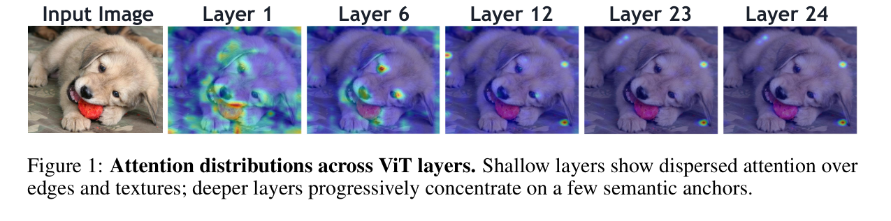

# CLIP CLS→Patch Attention Visualization (Fig.1)

Visualize **layer-wise** CLIP ViT CLS-to-patch attention and overlay each layer on the input image.

<p align="center">
  
</p>

---

## Code

| Role | Path |
|------|------|
| Per-layer CLS attention overlay | `scripts/visualize_clip_cls_attention.py` |

---

## What it does

1. Load a CLIP vision tower (`CLIPVisionModel`).
2. Run a forward pass with `output_attentions=True`.
3. For **every** transformer block, average heads and take the CLS→patch row.
4. Bilinear-upsample the map to the model image size and overlay it (`jet`, alpha `0.45`).
5. Save one PNG per layer under a folder named after the image.

---

## How to run

```bash
python scripts/visualize_clip_cls_attention.py \
  --vision-tower clip-vit-large-patch14-336 \
  --input-dir result/cls_attention_input \
  --output-dir result/cls_attention_coco101062 \
  --device cpu
```

| Flag | Default | Meaning |
|------|---------|---------|
| `--vision-tower` | `clip-vit-large-patch14-336` | Local CLIP vision path or HuggingFace id |
| `--input-dir` | `data` | Directory of images |
| `--output-dir` | `visualization_outputs/cls_attention` | Where overlays are written |
| `--alpha` | `0.45` | Overlay opacity |
| `--device` | `cuda` if available, else `cpu` | Inference device |

---

## Outputs

```text
<output-dir>/<image_stem>/<image_stem>_layer_01.png
...
<output-dir>/<image_stem>/<image_stem>_layer_24.png
```

### Example results

Source image: `result/source/COCO_test2015_000000101062.jpg`

Per-layer overlays (layers 01–24):

```text
result/cls_attention_coco101062/COCO_test2015_000000101062/COCO_test2015_000000101062_layer_01.png
...
result/cls_attention_coco101062/COCO_test2015_000000101062/COCO_test2015_000000101062_layer_24.png
```
