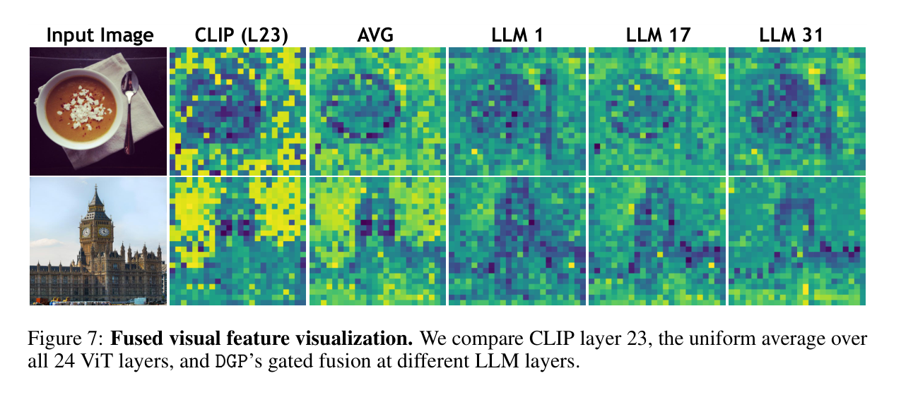

# Fused Visual Feature Visualization (Fig.7)

Scripts for the spatial feature maps used in the paper's fused-feature figure:

1. **Baselines** (CLIP only, no question): penultimate ViT layer, and the mean of ViT layers 1–24.
2. **Gated fusion** (question-conditioned): fuse 24 ViT layers with per-LLM-layer router weights from a trained checkpoint.

<p align="center">
  
</p>

---

## Code

| Role | Path |
|------|------|
| ViT penultimate (layer 23) feature map | `scripts/visualize_vit23_feature_map.py` |
| Mean of ViT layers 1–24 | `scripts/visualize_vit_avg_feature_map.py` |
| Question-conditioned gated fused maps | `scripts/visualize_gated_fused_feature_map.py` |

---

## A. CLIP baselines (no LLM / no question)

Shared options:

- **Aggregation** `--agg`: `l2` / `mean` / `pca` / `channel`
- **Normalization** `--norm_mode`: `percentile` (default p5–p95) / `minmax` / `none`
- Optional shared `vmin`/`vmax` via `--shared_norm_from`

Defaults: `--model_path clip-vit-large-patch14-336`, `--input_path datafeature`, `--output_dir datafeature-visualization`, `--agg pca`.

### Penultimate layer (ViT-23)

```bash
python scripts/visualize_vit23_feature_map.py \
  --input_path <IMAGE_OR_DIR> \
  --model_path clip-vit-large-patch14-336 \
  --agg pca \
  --output_dir datafeature-visualization
```

### Average of layers 1–24

```bash
python scripts/visualize_vit_avg_feature_map.py \
  --input_path <IMAGE_OR_DIR> \
  --model_path clip-vit-large-patch14-336 \
  --agg pca \
  --output_dir datafeature-visualization
```

Outputs: one PNG per image, `{stem}_{suffix}_{agg}.png` (`--suffix` default `vit23`).

---

## B. Gated fused features (needs a trained checkpoint and a question)

`scripts/visualize_gated_fused_feature_map.py` loads a checkpoint that has `layerwise_fusion`, runs a short `generate` to collect router weights (LLM layer × 24 ViT layers), then:

1. Reads all 24 ViT patch feature maps from the vision tower.
2. For each selected LLM layer, takes a weighted sum of those 24 patch tensors.
3. Aggregates `[N, D] → [H, W]` (`rms` by default) and saves a heatmap.

Fusion stays in ViT space (no mm_projector). Weights depend on the question.

### Single image

```bash
python scripts/visualize_gated_fused_feature_map.py \
  --model_path <CHECKPOINT_DIR> \
  --image_path <PATH_TO_IMAGE.jpg> \
  --question "Describe this image in detail." \
  --layers all \
  --agg rms \
  --save_mean_map \
  --output_dir datafeature-visualization/gated_fusion \
  --device cuda:0 \
  --device_map cuda:0
```

### Batch JSONL

Each line: `{"image":"xxx.jpg","question":"..."}`

```bash
python scripts/visualize_gated_fused_feature_map.py \
  --model_path <CHECKPOINT_DIR> \
  --qa_jsonl <qa.jsonl> \
  --image_root <IMAGE_DIR> \
  --max_samples 10 \
  --output_dir datafeature-visualization/gated_fusion
```

| Flag | Meaning |
|------|---------|
| `--layers` | `all` or a comma list, e.g. `0,8,16,24,31` |
| `--image_process_mode` | `clip` (default, same as the baseline scripts) or `llava_pad` |
| `--save_mean_map` | Also save the mean over the selected LLM layers |
| `--agg` | `l2` / `mean` / `rms` / `pca` / `channel` |

### Outputs

```text
datafeature-visualization/gated_fusion/<image_stem>/
  <stem>_llm00_fused_rms.png
  ...
  <stem>_llm31_fused_rms.png
  <stem>_llm_mean_fused_rms.png   # if --save_mean_map
```

---

## Example results

Source image: `result/source/COCO_test2015_000000130015.jpg`

| Figure | Path |
|--------|------|
| ViT-23 (penultimate) map | `result/datafeature-visualization-CLIP-2/COCO_test2015_000000130015_vit23_channel_c256.png` |
| Mean of ViT layers 1–24 | `result/datafeature-visualization-avg/COCO_test2015_000000130015_vit23_channel_c256.png` |
| Gated fusion, LLM layers 00–31 | `result/datafeature-visualization-gate/COCO_test2015_000000130015_llm00_fused_channel_c256.png` … `COCO_test2015_000000130015_llm31_fused_channel_c256.png` |
