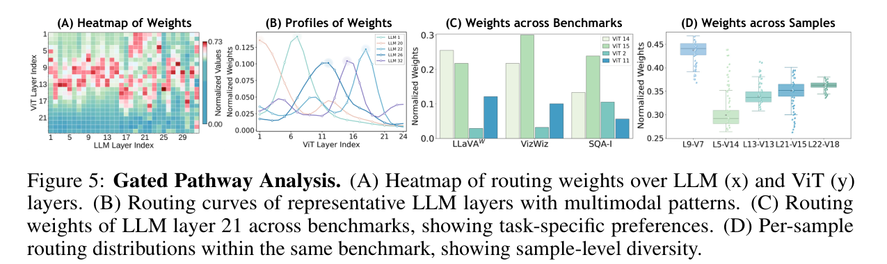

# Router Weight Collection & Visualization

This document describes how to **collect** layer-wise routing weights during inference and how to **plot** the figures used in our analysis (LLM × ViT routing heatmap, routing curves, and cross-benchmark bars).

<p align="center">
  
</p>

---

## 1. Collecting router weights (inference)

### Code

| Role | Path |
|------|------|
| Collect weights while answering VQA | `llava/eval/model_vqa_loader_with_router_stats.py` |
| Merge multi-GPU chunk stats | `llava/eval/merge_router_stats.py` |
| Example launch scripts | `scripts/v1_5/eval/pope_sft_with_router_stats_8gpu.sh`, `scripts/v1_5/eval/pope_pt_with_router_stats_8gpu.sh`, `scripts/v1_5/eval/sqa_crossattetion.sh` |

### What is collected

For each sample, the loader enables collection on `layerwise_fusion` and records:

1. **Pre-router** (optional): weights over **24 ViT layers** before LLM layer 0 → shape roughly `[24]`
2. **LLM routers**: one router per LLM layer → **32 × 24** weights (LLM layer × ViT layer)

The merged JSON typically contains:

- `metadata` (model path, dataset, num samples, …)
- `llm_router.mean_weights` — dataset-average `[32][24]` matrix
- `pre_router` — aggregate for the pre-LLM router (if present)
- `per_sample_weights` — list of per-question routing tensors (for sample-level plots)

### How to run (example: POPE, 8 GPUs)

```bash
# Edit MODEL_PATH inside the script if needed, then:
bash scripts/v1_5/eval/pope_sft_with_router_stats_8gpu.sh
```

Core Python entry (conceptually):

```bash
python -m llava.eval.model_vqa_loader_with_router_stats \
  --model-path <CHECKPOINT> \
  --question-file <QUESTIONS.jsonl> \
  --image-folder <IMAGES> \
  --answers-file <chunk_answers.jsonl> \
  --router-stats-file <chunk_stats.json> \
  ...

python -m llava.eval.merge_router_stats \
  --input-dir <router_stats_dir> \
  --output-file <merged-router-weights.json>
```

### Example result

Merged router weights:

```text
result/Gated-Pathway/llava-v1.5-7b-router-weights.json
```

---

## 2. ViT × LLM weight matrix = routing heatmap

### Code

`scripts/plot_router_heatmap.py`

Also supports a **pre-router** single-row heatmap over 24 ViT layers.

### Example command

Plot the POPE mean matrix in `llava-v1.5-7b-router-weights.json` (Table 11):

```bash
python scripts/plot_router_heatmap.py \
  --json-path result/Gated-Pathway/llava-v1.5-7b-router-weights.json \
  --output-dir result/Gated-Pathway \
  --title "Gated Connection Weights on POPE"
```

Useful flags:

- `--rounded-cells` — rounded cell style
- `--use-per-sample` — build matrix from `per_sample_weights` (average all samples unless a sample is selected)
- `--question-id <ID>` — one sample heatmap (implies per-sample mode)
- `--sample-idx <N>` — 0-based index into `per_sample_weights`

### Example figure

```text
result/Gated-Pathway/popellava-v1.5-7b-llm-router-heatmap.png
```

---

## 3. Routing curves (representative LLM layers)

### Code

`scripts/plot_router_curves.py`

For selected (or all) LLM layers, plots routing weight vs ViT layer index (raw + optional Gaussian-smoothed curves).

### Example command

```bash
python scripts/plot_router_curves.py \
  --json-path result/Gated-Pathway/llava-v1.5-7b-router-weights.json \
  --output-dir result/Gated-Pathway
```

Example curves:

```text
result/Gated-Pathway/llava-v1.5-7b-llm-router-curves.png
result/Gated-Pathway/llava-v1.5-7b-selected-raw-smooth-curves-single.png
```

---

## 4. Cross-benchmark bars (same LLM layer)

### Code

`scripts/plot_router_bench_group_bars.py`

Grouped bars for a fixed LLM layer across benchmarks (defaults point at SEED / LLaVA-W / VizWiz / GQA router JSONs — update paths to your files).

### Example command

```bash
python scripts/plot_router_bench_group_bars.py \
  --llm-layer 21 \
  --output <output.png>
```
